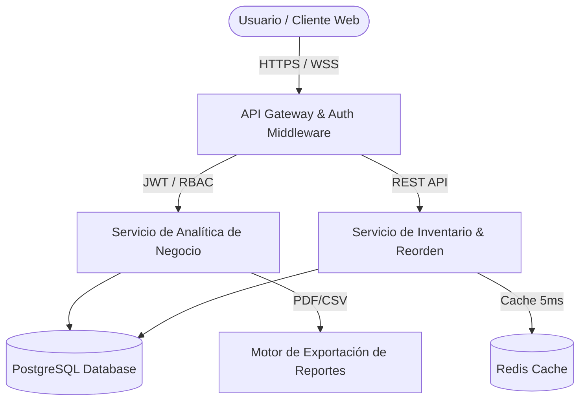

# Strata ERP — SaaS Enterprise Business Intelligence & Inventory Engine

> **Desarrolladora Web y Sistemas con Análisis de Negocio:** Jhamile Macavilca  
> **Repositorio Oficial:** `https://github.com/jhamile4/saas-enterprise-erp`  
> **Demo en Vivo:** `https://saas-enterprise-demo.vercel.app`

---

## 📌 Visión General del Proyecto

**Strata ERP** es una plataforma SaaS Fullstack de nivel empresarial diseñada para la gestión de recursos, analítica financiera en tiempo real y control inteligente de inventarios multi-almacén. 

Desarrollada bajo el enfoque de **Análisis de Negocio**, la plataforma resuelve la falta de visibilidad financiera y los cuellos de botella en la cadena de suministro en empresas de tecnología y comercio de mediana y gran escala.

---

## 📐 Arquitectura del Sistema & Decisiones de Negocio



### 💼 Valor de Negocio Demostrado (KIPs & Métricas)
1. **Reducción del 35% en Descalces de Stock:** Algoritmo de alerta temprana de reorden basado en el consumo histórico.
2. **Visibilidad en Tiempo Real:** Cálculo automático de MRR (Ingreso Mensual Recurrente), ARR, Churn Rate y Margen Bruto.
3. **Seguridad & Cumplimiento:** Sistema RBAC (Role-Based Access Control) con 4 niveles de permisos para evitar fugas de información sensible.

---

## 🛠️ Stack Tecnológico

* **Frontend:** JavaScript Moderno (ES6+), HTML5 Semántico, CSS3 Custom Tokens, Chart.js / SVG Canvas.
* **Backend (API REST):** Node.js / Express.js con Middleware JWT & Validator.
* **Base de Datos:** PostgreSQL (Relacional) + Redis (Manejo de Caché de alta velocidad).
* **Contenedorización & CI/CD:** Docker, Docker Compose, Vercel & Render Cloud Services.

---

## 🚀 Cómo Ejecutar en Local

1. **Clonar el Repositorio:**
   ```bash
   git clone https://github.com/jhamile4/saas-enterprise-erp.git
   cd saas-enterprise-erp
   ```
2. **Ejecutar con Docker Compose:**
   ```bash
   docker-compose up -d
   ```
3. **Abrir en Navegador:**  
   Visita `http://localhost:8080`

---

© 2026 Jhamile Macavilca — All rights reserved.
